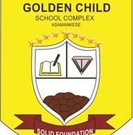
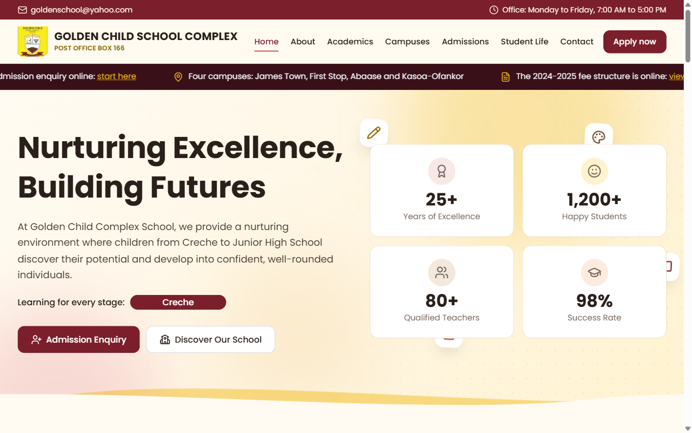
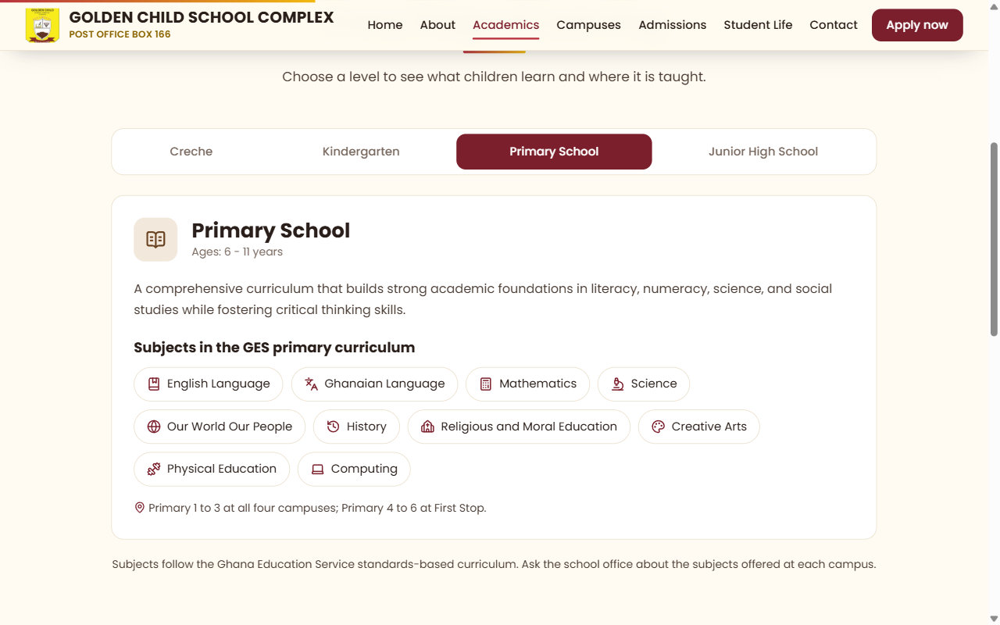
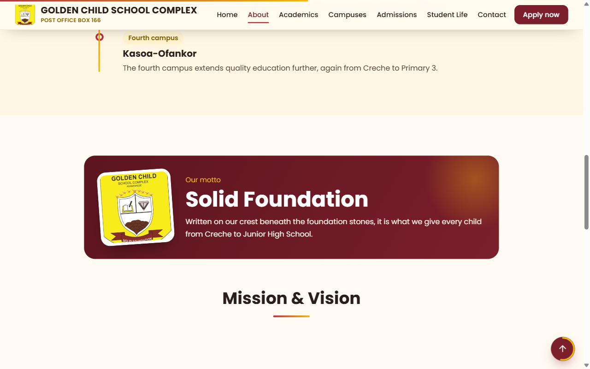
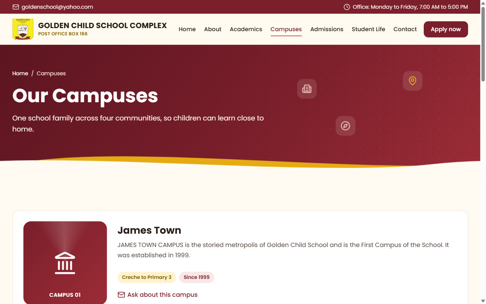
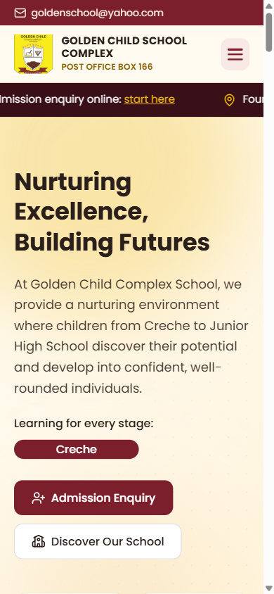
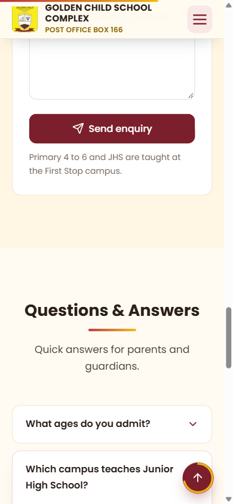

<div align="center">



# Golden Child Complex School

**The website of Golden Child Complex School, Asamankese, Ghana: Creche to Junior High School across four campuses.**

*Motto: Solid Foundation*

[**Visit the website**](https://ohenemanaf.github.io/goldenchild-web/)


</div>



| Academics | Our motto | Campuses |
|---|---|---|
|  |  |  |

| Phone: home | Phone: questions and answers |
|---|---|
|  |  |

## Pages

| Page | What parents find there |
|---|---|
| [Home](https://ohenemanaf.github.io/goldenchild-web/) | Announcements, school at a glance, programmes, values, campuses, achievements, success stories, news |
| [About](https://ohenemanaf.github.io/goldenchild-web/about.html) | Our story from 1999, the motto, mission and vision, core values |
| [Academics](https://ohenemanaf.github.io/goldenchild-web/academics.html) | Creche, Kindergarten, Primary and JHS: ages, GES curriculum subjects, and the campus that teaches each level |
| [Campuses](https://ohenemanaf.github.io/goldenchild-web/campuses.html) | James Town, First Stop, Abaase and Kasoa-Ofankor, with a levels-by-campus table |
| [Admissions](https://ohenemanaf.github.io/goldenchild-web/admission.html) | The four steps, required documents, fees, an online enquiry form, and questions and answers |
| [Fees](https://ohenemanaf.github.io/goldenchild-web/fee.html) | The 2024-2025 fee structure and payment options |
| [Student Life](https://ohenemanaf.github.io/goldenchild-web/student-life.html) | Science Fair, sports and Cultural Day |
| [Contact](https://ohenemanaf.github.io/goldenchild-web/contact.html) | Message form, address, office hours, campuses |

## Design

- **Colours from the school crest:**
  - maroon from the ribbon, for the top bar, buttons and page headers
  - crest gold, for highlights, stars and waves
  - warm cream, for the background
  - brown from the foundation stones, for accents
- **Type:** Poppins, served from this repository.
- **Icons:** [Lucide](https://lucide.dev), one consistent set. Pages use icons rather than stock or AI photos, so nothing on the site pretends to show the school.

### Motion

- An opening sequence on every page, with floating school icons and slowly drifting colour glows.
- The levels rotate in the home hero (Creche, Kindergarten, Primary School, Junior High School).
- An announcements ticker, a scroll-progress bar, and moving wave dividers.
- Sections slide, zoom or flip into view, and figures count up when they appear.
- The history timeline fills as you scroll, and a highlight slides between the tabs on the Academics page.
- A success-stories carousel that advances on its own, with swipe, arrows and dots.
- A gentle 3D tilt on cards, a circle-reveal phone menu, a compacting header, a back-to-top button with a progress ring, and page-to-page transitions.

**Accessibility:**
- All motion turns off for visitors who choose "reduce motion" on their device.
- Everything reads fully without JavaScript.
- Keyboard focus is always visible, and there's a "skip to content" link.

## Built to be light

| | Before (2025 site) | Now |
|---|---|---|
| Home page download | ~6.8 MB, 20 requests | under 200 KB |
| Whole site | ~23 MB | ~330 KB |
| Third-party scripts and images | Tailwind CDN, icon CDN, hotlinked AI images | none |

Everything is served from this repository. There's no framework and no build tooling to install.

## Editing the site

The header and footer are written once and shared by every page.

```
src/layout.html        header, footer and page shell (one copy for all pages)
src/pages/*.html       the content of each page
tools/build.mjs        assembles the pages (Node.js only, no packages)
assets/css/site.css    all styles; colours are defined at the top
assets/js/site.js      menu, scroll effects, counters, carousel, tabs, forms
assets/icons.svg       the icon set
assets/fonts/          Poppins
```

1. Edit a page in `src/pages/`, or the header and footer in `src/layout.html`.
2. Run `node tools/build.mjs` to regenerate the HTML files in the repository root.
3. Commit and push to `main`. GitHub Pages publishes the site within a minute or two.

Two shortcuts are available inside `src/pages`:
- `{{icon:name}}` inserts an icon. The build stops with a clear message if that icon isn't in `assets/icons.svg`.
- `{{wave}}` adds the moving wave at the bottom of a page header.

### Forms

The site has no server, so the contact and admission-enquiry forms open the visitor's email app. The message arrives ready to send to **goldenschool@yahoo.com**.

### Adding real photos

Real photos of the school would make the biggest difference. To add one (with permission for any children shown):

1. Resize it to about 1200 px wide, and save it as JPG or WebP under 200 KB.
2. Put it in `assets/images/`, for example `assets/images/campus-james-town.jpg`.
3. Add it to the matching card in `src/pages/`, then rebuild:
   ```html
   
   ```

## Content to confirm with the school

The site only shows what the school has stated, plus facts that hold for every Ghanaian basic school (the GES curriculum and the BECE). These items came from the earlier website and should be confirmed or updated:

- [ ] Figures: 25+ years, 1,200+ students, 80+ teachers, 98% success rate, 96% BECE pass rate, 45+ awards, 12 national competitions, 850+ alumni
- [ ] The four awards listed under Recent Recognition
- [ ] The 2024-2025 fees. Three terms of Creche come to GH₵10,500, but the annual fee shows GH₵10,000.
- [ ] The three news items dated April to June 2025
- [ ] The postal address. Both P.O. Box 166 and P.O. Box 23, Asamankese appear.
- [ ] Not yet on the site: the phone number, staff and leadership, term dates, clubs, and real photos
